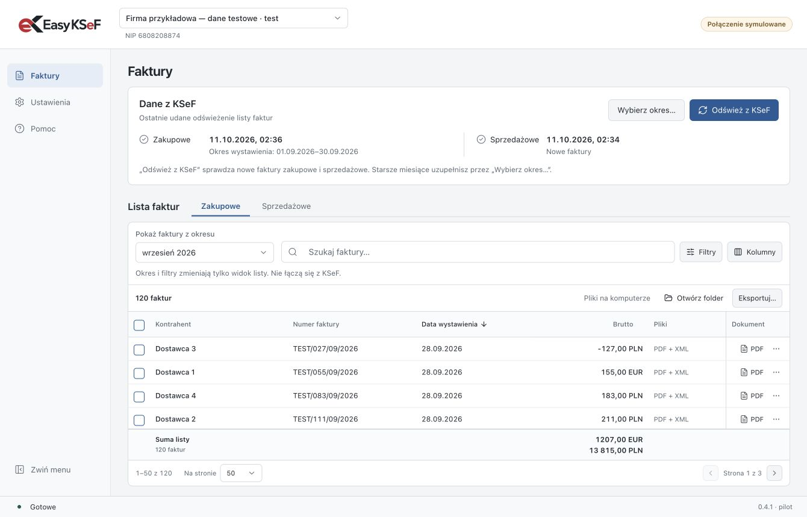

# Easy KSeF

**Sprawdź faktury z KSeF i przygotuj PDF-y oraz XML-e dla księgowości.**

Dla osób, które potrzebują faktur do pracy w biurze lub przekazania księgowości. Easy KSeF odświeża listę faktur wybranej firmy, pokazuje czas odczytu z KSeF i zapisuje dokumenty na komputerze. Bez ręcznego pobierania każdej faktury osobno.

**[Pobierz Easy KSeF 0.4.1 →](https://github.com/romanskk47/easy-ksef/releases/tag/v0.4.1)** · [Pierwsze uruchomienie](docs/pierwsze-kroki.md) · [Pomoc](docs/pomoc.md)

To bezpłatna, otwarta **wersja pilotażowa**. Instalatory nie mają jeszcze podpisu wydawcy; system może wyświetlić ostrzeżenie. [Co to oznacza przy instalacji](docs/instalacja.md).

## Wybierz swój komputer

| System | Pobierz | Wymagania |
| --- | --- | --- |
| Windows | [Instalator .exe](https://github.com/romanskk47/easy-ksef/releases/download/v0.4.1/Easy-KSeF-0.4.1-win-x64.exe) | Windows 10 lub 11, 64-bit |
| Mac z procesorem Apple M1/M2/M3/M4 lub nowszym | [Instalator .dmg](https://github.com/romanskk47/easy-ksef/releases/download/v0.4.1/Easy-KSeF-0.4.1-mac-arm64.dmg) | macOS 13 lub nowszy |
| Mac z procesorem Intel | [Instalator .dmg](https://github.com/romanskk47/easy-ksef/releases/download/v0.4.1/Easy-KSeF-0.4.1-mac-x64.dmg) | macOS 13 lub nowszy |
| Linux | [AppImage](https://github.com/romanskk47/easy-ksef/releases/download/v0.4.1/Easy-KSeF-0.4.1-linux-x86_64.AppImage) | x86-64, środowisko graficzne i systemowy sejf haseł |
| Ubuntu / Debian | [Pakiet .deb](https://github.com/romanskk47/easy-ksef/releases/download/v0.4.1/Easy-KSeF-0.4.1-linux-amd64.deb) | x86-64, środowisko graficzne i systemowy sejf haseł |

Nie potrzebujesz Pythona, Node.js ani osobnej instalacji .NET. Na Macu sprawdzisz procesor w menu Apple → **Ten Mac**. Wersje ZIP dla Maca i sumy SHA-256 są na [stronie wydania](https://github.com/romanskk47/easy-ksef/releases/tag/v0.4.1).

## Zacznij od trzech kroków

1. **Dodaj firmę.** Wpisz NIP, wybierz folder i wklej token z tego samego środowiska KSeF. Wystarczy uprawnienie **„Przeglądanie faktur”**. Instrukcja tworzenia tokena jest w aplikacji i [tutaj](docs/pierwsze-kroki.md).
2. **Uzupełnij historię.** Kliknij „Wybierz okres…”, wybierz „Cała dostępna historia” albo konkretny okres i rozpocznij odświeżanie. Program uzupełni listę, zapisze XML-y z KSeF, a potem przygotuje PDF-y.
3. **Wracaj po nowe.** „Odśwież z KSeF” sprawdza nowe faktury zakupowe i sprzedażowe jednym przyciskiem. Panel „Dane z KSeF” pokazuje osobno dla obu rodzajów czas i zakres ostatniego udanego odświeżenia. **Program nie sprawdza KSeF automatycznie w tle.**

**Czas w panelu „Dane z KSeF” dotyczy odczytu do aplikacji.** Przygotowanie PDF-ów jest osobnym etapem. Jeśli pojedynczy PDF się nie utworzy, potwierdzony odczyt danych pozostaje zapisany, a plik wymagający uwagi jest oznaczony na liście. Nieudana lub przerwana próba odczytu nie zastępuje poprzedniego udanego odświeżenia.

## Co oznaczają przyciski?

| Chcę… | Co zrobić |
| --- | --- |
| Sprawdzić nowe faktury w KSeF | **Odśwież z KSeF** — zakupy i sprzedaż wybranej firmy |
| Uzupełnić starsze miesiące albo całą historię | **Wybierz okres…** → „Cała dostępna historia” lub „Wybrany okres” |
| Znaleźć fakturę już w aplikacji | Użyj wyszukiwania, okresu i filtrów w sekcji **Lista faktur** |
| Zobaczyć pliki na dysku | **Otwórz folder** |
| Przekazać dokumenty księgowości | **Eksportuj…** → ZIP z PDF-ami, PDF-ami i XML-ami albo zestawienie Excel |

**Lista pokazuje dane faktur już zapisane w aplikacji.** Zmiana miesiąca lub filtrów przeszukuje ten lokalny zbiór. Eksport również korzysta z zapisanych danych i plików — nie odświeża KSeF i niczego sam nie wysyła. Bez zaznaczenia obejmuje całą przefiltrowaną listę, ze wszystkich stron; z zaznaczeniem — wybrane faktury.

Możesz dodać kilka firm. Każda ma osobny token i folder z NIP-em. Kwoty różnych walut są sumowane osobno. [Więcej o pracy z listą](docs/pierwsze-kroki.md#codzienna-praca).

## Twoje dane

Easy KSeF łączy się z usługami Ministerstwa Finansów, bez naszego serwera pośredniczącego. Nie ma analityki użytkowania. Token jest szyfrowany mechanizmem systemu operacyjnego. **PDF-y i XML-e w wybranym folderze nie są szyfrowane przez aplikację.** Folder synchronizowany przez OneDrive, iCloud lub inną usługę podlega jej ustawieniom.

Program służy do odczytu faktur. Nie wystawia ich, nie księguje i nie zastępuje programu księgowego. Obsługuje faktury, w których firma jest nabywcą lub sprzedawcą; nie pobiera odrębnego zakresu dokumentów podmiotu trzeciego. Nie jest oficjalną aplikacją Ministerstwa Finansów.

[Dokładnie: bezpieczeństwo i prywatność](docs/bezpieczenstwo.md) · [Ograniczenia pilotażu](docs/pomoc.md#ograniczenia-wersji-pilotażowej)

## Coś nie działa albo czegoś brakuje?

[Zgłoś problem](https://github.com/romanskk47/easy-ksef/issues/new/choose) i opisz, co chciałeś zrobić oraz co zobaczyłeś. Nie dołączaj tokenów ani prawdziwych faktur. Luki bezpieczeństwa zgłaszaj [prywatnie](SECURITY.md).

Kod aplikacji jest udostępniony na [licencji MIT](LICENSE). Możesz go używać, zmieniać i rozwijać. Easy KSeF korzysta m.in. z otwartych projektów Ministerstwa Finansów: [klienta KSeF](https://github.com/CIRFMF/ksef-client-csharp) i [generatora PDF](https://github.com/CIRFMF/ksef-pdf-generator). Ich licencje pozostają w mocy; informacje o zależnościach są dołączone do aplikacji.

Chcesz pomóc w rozwoju? Zobacz [CONTRIBUTING](CONTRIBUTING.md) i [instrukcję dla programistów](docs/development.md).
